<div align="center">


# TarangFX

### A studio-grade audio editor for Android that never touches the internet.

**Trim · Merge · Multitrack mix · Split · Record · Convert · Video → audio · AI denoise · FX & EQ · Tags**

[](https://github.com/PN-Projects/TarangFX_android/actions/workflows/ci.yml)
[](https://github.com/PN-Projects/TarangFX_android/actions/workflows/release.yml)
[](https://github.com/PN-Projects/TarangFX_android/releases/latest)
[](LICENSE)


[**Download**](#-download) · [**Features**](#-features) · [**Architecture**](#-architecture) · [**Algorithms**](#-algorithms-and-dynamic-programming) · [**Contributing**](#-contributing) · [**Code of Conduct**](#-code-of-conduct)

*Made with ♥ at **PN-projects** by **TeamPrabodhNandini***

</div>

---

*Tarang* (तरंग) means **wave**. TarangFX is a free, open-source and ad-free audio workstation for
Android phones. A Kotlin + Jetpack Compose interface sits on a hand-written **C++20 audio engine**
built on Google Oboe, FFmpeg, Rubber Band, TagLib and ONNX Runtime. Everything runs on the device,
including the neural noise removal: the app has **no internet permission at all**, no analytics, no
accounts, no ads and no paywalls.

<table>
  <tr>
    <td align="center">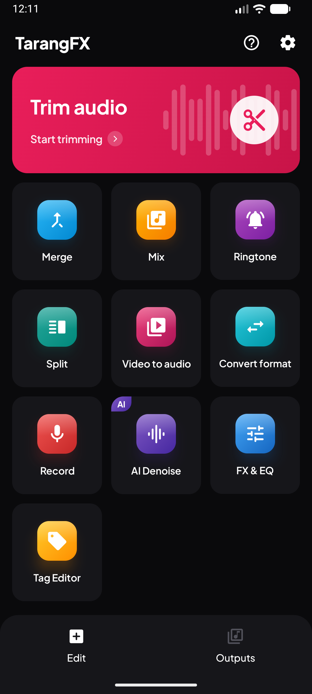<br/><sub><b>Home</b></sub></td>
    <td align="center">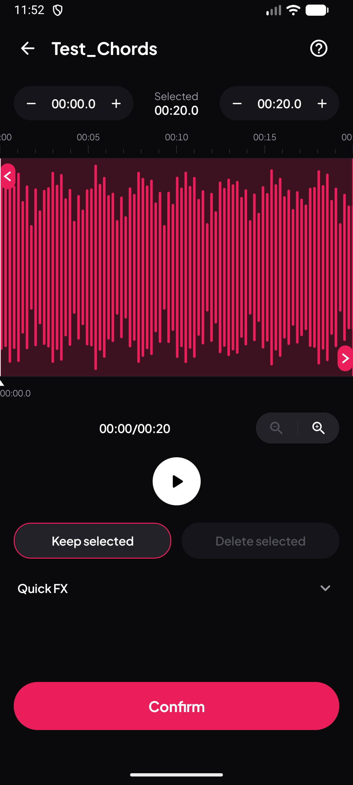<br/><sub><b>Trim</b> (sample-accurate)</sub></td>
    <td align="center">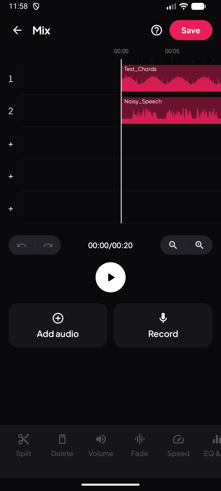<br/><sub><b>Multitrack mix</b></sub></td>
    <td align="center">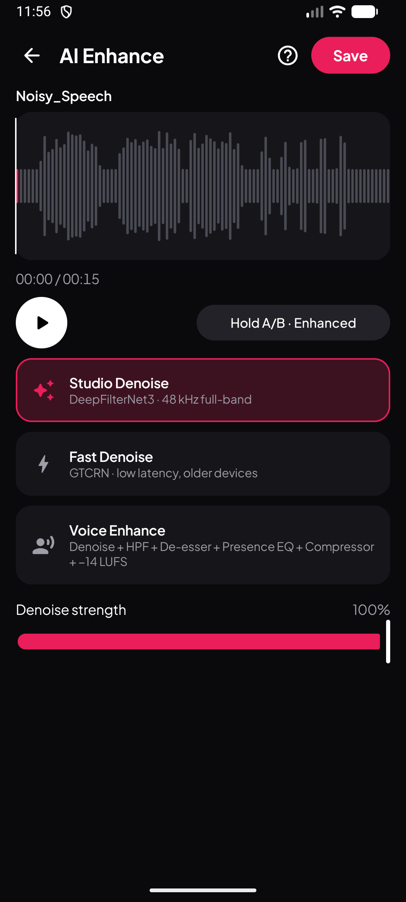<br/><sub><b>AI Enhance</b></sub></td>
    <td align="center">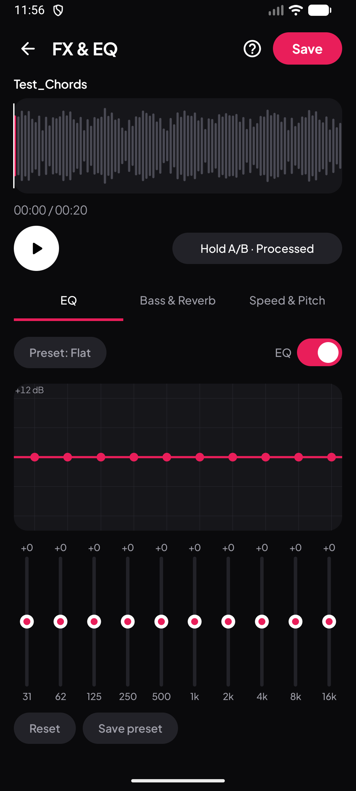<br/><sub><b>FX & EQ</b></sub></td>
  </tr>
</table>

> [!IMPORTANT]
> TarangFX is verified by an automated test pipeline on x86_64 emulators. It **requires human review**
> (security, licensing, audio correctness and testing on real phones) before you rely on it in
> production. See [Known limitations](#known-limitations).

<details>
<summary><b>📑 Table of contents</b></summary>

- [✨ Features](#-features)
- [📥 Download](#-download)
- [🧭 Principles](#-principles)
- [🧱 Architecture](#-architecture)
  - [System overview](#system-overview)
  - [Real-time playback threading](#real-time-playback-threading)
  - [The processing chain](#the-processing-chain)
  - [Export and loudness normalisation](#export-and-loudness-normalisation)
  - [On-device AI denoise](#on-device-ai-denoise)
- [🧠 Algorithms and dynamic programming](#-algorithms-and-dynamic-programming)
- [⚡ Performance](#-performance)
- [🧪 Quality and testing](#-quality-and-testing)
- [🚀 Versioning and releases](#-versioning-and-releases)
- [🔧 Build from source](#-build-from-source)
- [📂 Project structure](#-project-structure)
- [🤝 Contributing](#-contributing)
- [🚦 Moderation guide](#-moderation-guide)
- [📜 Code of Conduct](#-code-of-conduct)
- [🔒 Security](#-security)
- [📦 Third-party components](#-third-party-components)
- [📄 License](#-license)

</details>

---

## ✨ Features

| | Tool | What it does |
|:-:|---|---|
| ✂️ | **Trim** | Sample-accurate keep/delete selection, draggable handles, pinch-zoom waveform, fades, quick FX |
| 🔗 | **Merge** | Join files in any order with per-clip trim, FX and speed, plus crossfades |
| 🎚️ | **Multitrack mix** | Tracks and clips, drag with magnetic snapping, split, fades, mute/solo, per-clip FX and AI denoise, undo/redo, live mic overdub, drafts |
| 🪓 | **Split** | Multiple split points, delete parts, batch export with track numbers |
| 🔔 | **Ringtone** | Saves straight into the system ringtone, notification or alarm folders |
| 🎙️ | **Record** | WAV (16/24-bit), FLAC or M4A, input gain, pause/resume, live waveform, optional live denoise |
| 🔄 | **Convert** | MP3, AAC, M4A, FLAC, WAV, OPUS, OGG and ALAC, in batches, with tags and cover art carried over |
| 🎬 | **Video → audio** | Bit-exact stream copy (no re-encoding, no quality loss) or transcode |
| 🤖 | **AI Denoise** | *Studio* (DeepFilterNet3, 48 kHz) and *Fast* (GTCRN, 16 kHz) neural models, fully on-device |
| 🗣️ | **Voice Enhance** | Denoise + high-pass + dynamic de-esser + presence EQ + compressor, normalised to −14 LUFS (EBU R128) |
| 🎛️ | **FX & EQ** | 10-band EQ with presets, bass boost, reverb presets, speed and pitch (Rubber Band), hold-to-compare A/B |
| 🏷️ | **Tag editor** | Title, artist, album, year, track, genre and cover art (photo picker, auto-cropped) |
| 📁 | **Outputs** | Library of everything you made: play, rename, share, re-edit, set as ringtone, delete |

Editing is **non-destructive**: your original files are only ever read, and every export is a new
file in `Music/TarangFX/`.

## 📥 Download

Get the latest signed APK from **[Releases](https://github.com/PN-Projects/TarangFX_android/releases/latest)**:

| File | Install on | Size (v1.0.1) |
|---|---|---|
| `TarangFX-<version>-arm64-v8a.apk` | Android phones and tablets (Android 8.0+, 64-bit ARM) | 56.7 MB |
| `TarangFX-<version>-x86_64.apk` | Emulators and x86 Chromebooks | 65.5 MB |

1. Download the APK, plus `SHA256SUMS.txt` from the same release.
2. Optionally verify it: `sha256sum -c SHA256SUMS.txt --ignore-missing`.
3. Open the APK on your phone. You may need to allow *Install unknown apps* for your browser or file manager.

Every release is built and signed by CI from a tagged commit on `main`, so the source of any APK is
exactly this repository at that tag.

## 🧭 Principles

These are non-negotiable, enforced in review **and** by automated checks:

| Principle | How it is enforced |
|---|---|
| **100% offline** | No network permission. `verifyApkHygiene*` fails the build if `INTERNET` or `ACCESS_NETWORK_STATE` ever reaches the merged manifest |
| **Free for everyone** | No ads, paywalls, subscriptions, accounts or telemetry; the code is AGPL-3.0 |
| **Non-destructive** | Sources are opened read-only through file descriptors; exports are always new files |
| **Respect the device** | Fixed-size streaming: memory never grows with file length. The real-time audio thread never allocates, locks or does I/O |
| **Open tooling** | The build and CI use only open-source tools (for example, setup-gradle stays on MIT v5 because v6 bundles a proprietary component) |

---

## 🧱 Architecture

### System overview

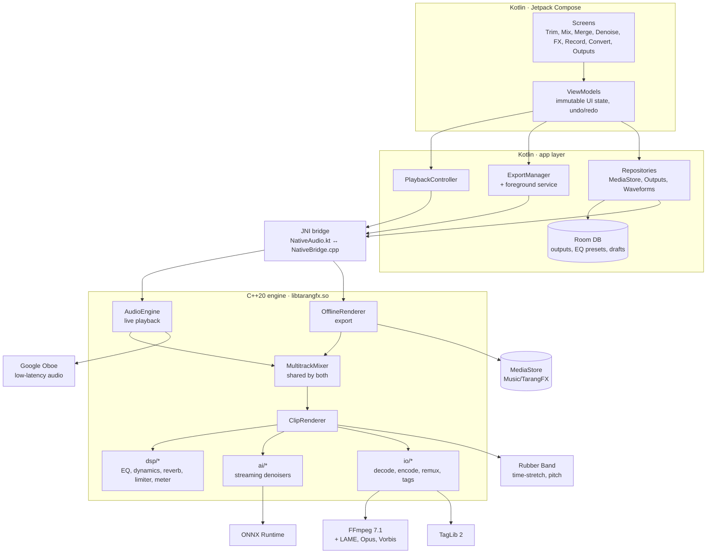

The key design decision is that **live preview and export share one `MultitrackMixer`**. What you
hear while editing is computed by exactly the same code that writes the exported file, so the two
can never drift apart.

### Real-time playback threading

Audio callbacks on Android run on a high-priority thread with a deadline of a few milliseconds.
Missing it produces an audible click. TarangFX therefore splits playback across three threads, and
the real-time one does almost nothing:

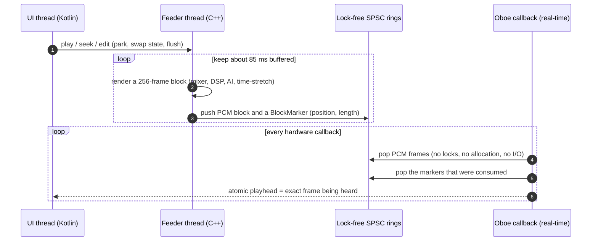

- **Rings:** a 32,768-sample PCM ring and a 512-entry marker ring, both single-producer/single-consumer and lock-free.
- **Buffering:** the feeder keeps about 4,096 frames (≈ 85 ms at 48 kHz) queued. That's the edit-to-ear latency, and it gives heavy DSP and AI frames plenty of headroom.
- **Edits:** parameter changes (EQ, gain, reverb) are applied by the feeder *between* blocks, so they are glitch-free. Structural edits park the feeder, swap the project, flush the rings and re-seek.
- **Accurate playhead:** because each block carries a `BlockMarker`, the on-screen playhead shows the frame actually being heard, not the frame being rendered 85 ms ahead.

### The processing chain

Every clip runs through the same chain, and tracks are summed into a master chain:

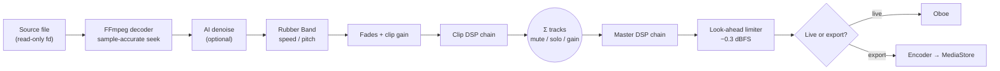

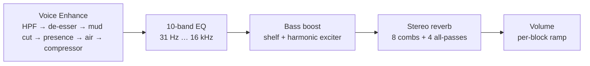

Stages that are switched off cost almost nothing: identity biquads, zero-wet reverb and disabled
voice-enhance return immediately without touching the samples (the tests verify this bit-exactly).

### Export and loudness normalisation

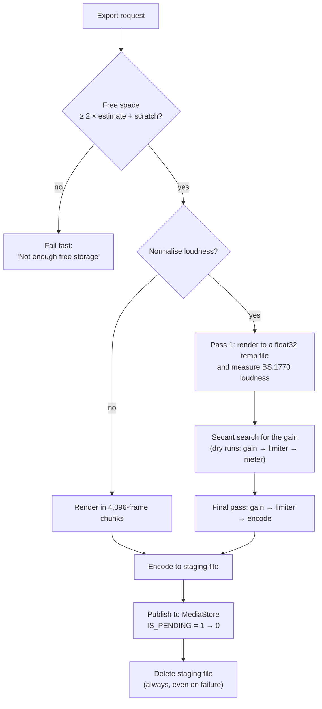

- **Staging location:** exports are staged in app-private *no-backup* storage, not the cache, because Android may purge caches at any moment under storage pressure.
- **Visibility:** a file only appears in other apps once it has been completely written (`IS_PENDING` → 0).
- **Background work:** exports run in a foreground service (`mediaProcessing` on Android 15+), with progress and Cancel.

### On-device AI denoise

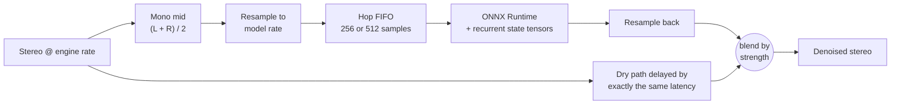

| Mode | Model | Rate | Framing | Latency |
|---|---|---|---|---|
| **Studio** | DeepFilterNet3 (torchDF streaming export) | 48 kHz | 512-sample hop, ERB + deep filtering inside the graph, 13 state tensors | 1,536 samples |
| **Fast** | GTCRN | 16 kHz | 512-point FFT, 256 hop, periodic √Hann STFT done in C++ | 256 samples |

The resamplers' round-trip delay is **measured with an impulse when a denoiser is created** rather than assumed,
so the dry and wet paths stay sample-aligned and the strength slider blends them without comb
filtering.

---

## 🧠 Algorithms and dynamic programming

A phone has a small power budget, so TarangFX treats performance as an algorithm problem first and
a compiler problem second. Every technique below is in the code, covered by tests that compare it
against a brute-force reference, and backed by measurements.

| # | Problem | Technique | Cost |
|---|---|---|---|
| 1 | Drawing a waveform of a multi-hour file at 60 fps | **DP tabulation:** block + segment-tree range-maximum index | O(n) once, then O(log n) per bar |
| 2 | Peak limiting without clicks | **Monotonic deque** sliding-window minimum | O(1) amortised per sample |
| 3 | Integrated loudness (EBU R128 / BS.1770-4) | **Overlapping-subproblem reuse** of 100 ms hop energies | O(n), one `log10` per gate |
| 4 | Hitting exactly −14 LUFS after a non-linear limiter | **Safeguarded secant root finding** | 3–5 cheap dry runs |
| 5 | Moving audio to the real-time thread | **Lock-free SPSC ring buffer** | O(1), wait-free |
| 6 | Re-rendering only what changed after an edit | **Structural diffing** (memoised engine state) | O(clips) per edit |
| 7 | Multi-hour files in a few MB of RAM | **Streaming in fixed chunks** | O(1) memory in file length |
| 8 | Smooth parameter changes | **Coefficient ramps + control-rate decimation** | O(1) per sample, transcendentals 16× rarer |
| 9 | Undo/redo for complex projects | **Command pattern over immutable snapshots** | O(1) per operation, bounded memory |

### 1. Waveform range-maximum index (dynamic programming)

**Problem.** A bar on screen must show the loudest peak in the time span it covers. At 100 peaks
per second, a 60-minute file has **360,000 peaks**, so a fully zoomed-out view scans all of them
for every frame. During playback that is about 21 million reads per second, and the cost grows with
*file length* instead of *screen width*.

**Approach.** Group the peaks into blocks of 16 and tabulate a complete binary tree over the
block maxima **bottom-up**, the classic DP fill where every node reuses its two already-solved
children:

$$
\text{node}[i] = \max\big(\text{node}[2i],\ \text{node}[2i+1]\big), \qquad i = \text{size}-1, \dots, 1
$$

A query `max(from, to)` scans at most two partial blocks plus O(log n) tree nodes. Short ranges
(when zoomed in) use a direct scan, which is faster there.

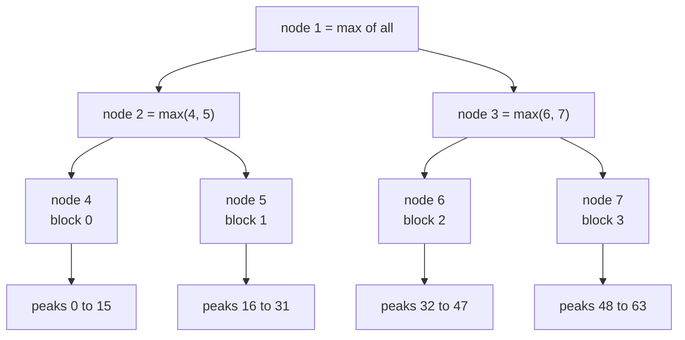

| | Naive scan | Indexed (`PeakRangeMax`) |
|---|---|---|
| Build | — | O(n) once, on the IO thread when the waveform loads |
| One bar | O(peaks under the bar) | O(log n) |
| One frame, 60-min file, zoomed out | ≈ 360,000 reads | ≈ 200 bars × ~30 steps |
| Extra memory, 60-min file | — | ≈ 256 KB |
| **Measured** | **108 µs / frame** | **7 µs / frame (14.7× faster)** |

Correctness: `PeakRangeMaxTest` compares it with brute force on 24,000 random ranges across
12 array sizes, plus every possible range of a 77-element array.
Code: [`domain/model/PeakRangeMax.kt`](app/src/main/java/com/pnprojects/tarangfx/domain/model/PeakRangeMax.kt).

### 2. Look-ahead limiter with a monotonic deque

**Problem.** To never exceed the ceiling $c$ (−0.3 dBFS), the limiter must already be turned down
*before* a peak arrives. The gain it needs at time $t$ is the minimum required gain over the
look-ahead window of $L$ samples (1.5 ms = 72 samples at 48 kHz):

$$
g_{\text{target}}(t) = \min_{k \in [\,t-L+1,\ t\,]} \ \min\!\Big(1,\ \frac{c}{|x_k|}\Big)
$$

Recomputing the minimum every sample costs O(L) per sample.

**Approach.** Keep a **monotonic deque** of candidate minima. A new sample removes every element
behind it that is no smaller, and the front leaves once it falls out of the window. Each sample is
pushed and popped at most once, so the cost is **O(1) amortised per sample**, independent of $L$.
The gain then ramps down linearly within the look-ahead, releases exponentially (80 ms), and a
tanh soft-knee stage guarantees the ceiling.

Correctness: a native test re-implements the limiter with an **O(n·L) brute-force window scan**
and requires identical output (max difference < 10⁻⁶).
Code: [`dsp/SoftLimiter.cpp`](app/src/main/cpp/dsp/SoftLimiter.cpp).

### 3. Loudness meter: reusing overlapping windows

**Problem.** EBU R128 / ITU-R BS.1770-4 measures loudness over **400 ms blocks that overlap by
75%**, then gates them twice (absolute −70 LUFS, relative −10 LU). Computing each block directly
would process every sample four times.

**Approach.** Each sample is K-weighted (two biquads in double precision) and its energy is added
to a **100 ms hop sum**. A 400 ms block is then just the mean of 4 consecutive hop sums: every hop
is computed once and reused by the four blocks that contain it.

$$
z_b = \tfrac{1}{4}\sum_{j=b}^{b+3} h_j, \qquad
L_K = -0.691 + 10\log_{10}\!\Big(\tfrac{1}{|J|}\sum_{b \in J} z_b\Big)
$$

The gates are compared in the **power domain** (one `log10` per gate instead of one per block).
The K-weighting filters are derived for any sample rate with the bilinear-transform formulation
popularised by libebur128 (MIT).

Result: **conforms to EBU Tech 3341** test cases 1–4 within ±0.1 LU (native tests), and runs
**2.4× faster** than the previous implementation.
Code: [`dsp/Dynamics.cpp`](app/src/main/cpp/dsp/Dynamics.cpp).

### 4. Hitting −14 LUFS exactly: safeguarded secant search

**Problem.** Voice Enhance normalises to −14 LUFS, but a limiter sits after the gain. Post-limiter
loudness $L(g)$ increases with gain $g$, but with a slope well below 1 LU/dB (about 0.3–0.4 on
speech), so "add the missing dB" undershoots and crawls. That's why an earlier version landed
at −14.6.

**Approach.** Treat it as root finding, $f(g) = L(g) - T = 0$. Each *dry run* streams the
float temp file through gain → limiter → meter without encoding, which is cheap. The next guess
uses the slope measured from the last two runs:

$$
g_{n+1} = g_n + \frac{T - L(g_n)}{s_n}, \qquad
s_n = \operatorname{clamp}\!\Big(\frac{L(g_n) - L(g_{n-1})}{g_n - g_{n-1}},\ 0.05,\ 1\Big)
$$

It keeps a **bracket** $[g_{lo}, g_{hi}]$ around the target and falls back to **bisection** if a
secant step would leave it. It stops at **±0.05 LU** (8 runs at most) and encodes with the best
gain it actually *measured*, never an untested guess.

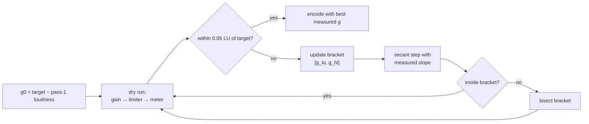

Result, measured independently with ffmpeg's EBU R128 filter: **−14.0 LUFS** for both mono and
stereo exports, converging in 3–5 dry runs.
Code: [`engine/OfflineRenderer.cpp`](app/src/main/cpp/engine/OfflineRenderer.cpp).

### 5. Lock-free single-producer/single-consumer ring buffer

The feeder thread writes and the real-time callback reads. The ring's capacity is a power of two,
so wrap-around is a bit-mask rather than a modulo or a branch. The read and write counters are
64-bit atomics published with **acquire/release** ordering, so the real-time side never locks,
waits or allocates. A native test pushes **2 million items** across two threads and checks that
every one arrives, in order.
Code: [`common/SpscRingBuffer.h`](app/src/main/cpp/common/SpscRingBuffer.h).

### 6. Structural diffing: rebuild only what changed

Most edits are parameter changes (EQ, gain, reverb amount). Rebuilding a clip's renderer would
re-open its decoder, reset the time-stretcher and audibly glitch. So every edit is **diffed against
the previous engine state**:

- `DspSettings.needsRebuildFrom()` in Kotlin mirrors `ClipRenderer::sameStructure()` in C++. Only
  speed changes, turning time-stretch or reverb on or off, or switching denoise model force a
  rebuild.
- The Mix screen compares a `structureKey` of the project, so a volume drag sends a cheap
  parameter update instead of reloading the whole timeline.

### 7. Streaming everything

Decoding, waveform extraction, AI inference, export and recording all work in fixed
**4,096-frame chunks**. Memory is O(1) in file length:

- A **60-minute** file edits in about **63 MB** (PSS) on the release build.
- Its waveform builds in about **2 s**.
- AI-denoising the full hour peaks at about **182 MB**.

Waveforms are cached at two levels: an in-memory LRU of the 12 most recent waveforms
(`LinkedHashMap` in access order), and a `.peaks` file on disk keyed by SHA-256 of the URI and size.

### 8. Filters that never click

All equalisers use RBJ Audio-EQ-Cookbook biquads in transposed direct form II, with double-precision
state. When a setting changes, coefficients **ramp linearly over 64 samples** (zipper-free), and a
biquad that has settled on identity is skipped entirely. The de-esser is a **dynamic EQ**: a
band-pass side-chain drives a minimum-phase bell cut at 7 kHz. Its gain is recomputed once every
16 samples and quantised to 0.25 dB, so the filter is only redesigned when the gain genuinely
changes. The compressor skips its dB→linear `pow()` whenever the signal is below the knee.

### 9. Undo/redo over immutable state

Editor state is a tree of immutable Kotlin data classes, so an edit creates a new state that shares
every unchanged branch with the old one. Undo/redo is a **command pattern** over these snapshots:
O(1) per operation, bounded to 100 entries so memory stays flat in long sessions.

---

## ⚡ Performance

Native DSP micro-benchmarks (stereo, 48 kHz, 4,096-frame blocks, release flags, x86_64 emulator):

| Module | ns / stereo frame | × real time (one core) |
|---|--:|--:|
| Single biquad | 3.7 | 5,600× |
| 10-band EQ | 36.6 | 570× |
| Bass boost | 18.8 | 1,100× |
| Stereo reverb | 20.0 | 1,040× |
| Compressor | 16.3 | 1,280× |
| De-esser | 8.2 | 2,550× |
| Voice Enhance (full) | 43.2 | 480× |
| Look-ahead limiter | 3.8 | 5,500× |
| Loudness meter | 5.0 | 4,200× |
| **Full chain, everything on** | **121** | **≈ 170×** |

Measured improvements from the optimisation work (same flags, A/B, median of 3 rounds):

| Module | Before | After | Change |
|---|--:|--:|---|
| De-esser | 22.8 ns | 8.3 ns | **2.7× faster**, and it now reduces sibilance as designed |
| Loudness meter | 11.7 ns | 4.9 ns | **2.4× faster**, and now EBU Tech 3341 conformant |
| Voice Enhance chain | 57.6 ns | 42.3 ns | 27% faster |
| Waveform frame (60 min) | 108 µs | 7 µs | **14.7× faster** |

Build-level optimisation:

- **Native code:** `-O3` with ThinLTO, plus `-fno-math-errno` and FMA contraction. `-ffast-math` is deliberately not used, because it would silently disable NaN/Inf checks.
- **Kotlin:** R8 full-mode shrinking.
- **Packaging:** one APK per ABI, and native libraries aligned for 16 KB pages (Android 15+).

> [!NOTE]
> Emulator numbers run on the host's x86 CPU. Phones are slower, so read "× real time" as relative.

## 🧪 Quality and testing

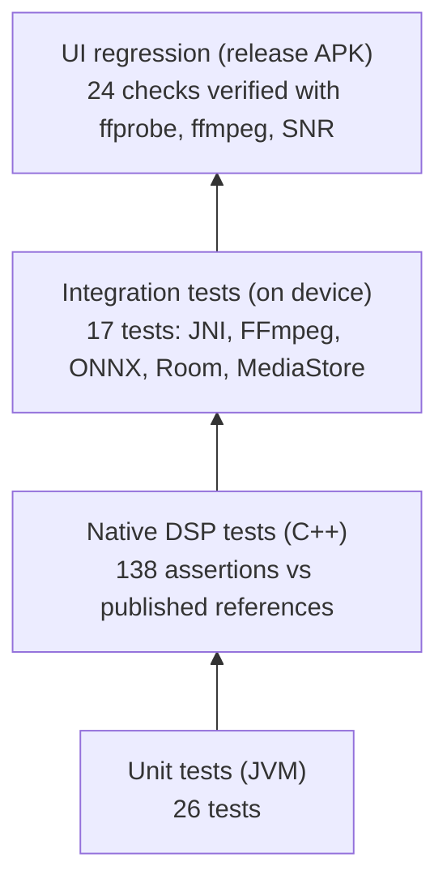

| Suite | What it proves | Runs |
|---|---|---|
| **Unit tests** | Range-max index vs brute force, undo/redo, renderer rebuild rules, Kotlin→C++ JSON contract, export size estimates, formatting | Every PR |
| **Native DSP tests** | RBJ biquad gains, Butterworth −3 dB point, **EBU Tech 3341** loudness cases, limiter ceiling/latency and deque vs brute force, compressor curve, de-esser selectivity, bit-exact bypasses, 2 M-item threaded ring test, plus benchmarks | Every PR (host build) |
| **Integration tests** | Sample-accurate trims (≤ 1 LSB), 2× speed, multitrack mixes in 4 codecs, TagLib round trip, both AI models keep the exact length, MediaStore folders and flags, Room DAOs, bad input never crashes | Every PR (API 34 emulator) |
| **Versioning self-test** | Every rule of the release policy | Every PR and release |
| **UI regression** | Every feature through the real UI on the signed release build: AI denoise SNR 6.9 → 37.1 dB (Studio) / 50 dB (Fast), Voice Enhance −14.0 LUFS, 60-min file < 300 MB, no crashes | Before releases (`tools/e2e/regression.ps1`) |

---

## 🚀 Versioning and releases

Releases are fully automated: **nobody edits version numbers by hand.**

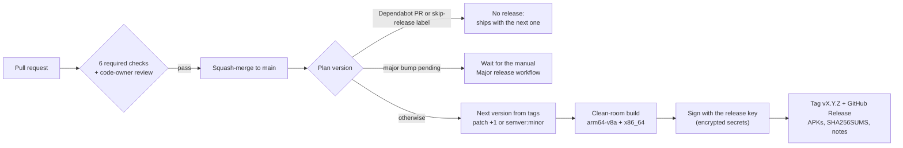

| Event | Result |
|---|---|
| A pull request is merged | Next **patch** (`1.4.6 → 1.4.7`) |
| The merged PR has the `semver:minor` label | Next **minor** (`1.4.6 → 1.5.0`) |
| Patch reaches 99 | Rolls over (`1.4.99 → 1.5.0`); minor and patch are each limited to 0–99 |
| Version reaches `x.99.99` | Automatic releases stop: a **major release** is required |
| A Dependabot PR is merged, or the PR has `skip-release` | **No release**; the change ships with the next real release |

Android's version code always increases:

$$
\text{versionCode} = 10000 \cdot \text{major} + 100 \cdot \text{minor} + \text{patch}
$$

**The versioning file.** [`version.properties`](version.properties) holds only the major line
(`major=1`). It is required, and the **Version guard** check fails a pull request when:

- the file is missing or malformed (anything other than one `major=<integer>`);
- `major` is anything except the released major or exactly +1 (no skipping, no downgrades);
- a major bump is mixed with any other change;
- a version number is hard-coded in `app/build.gradle.kts`.

Gradle also refuses to build a version outside the file's major line.

**Major release** (maintainers only):

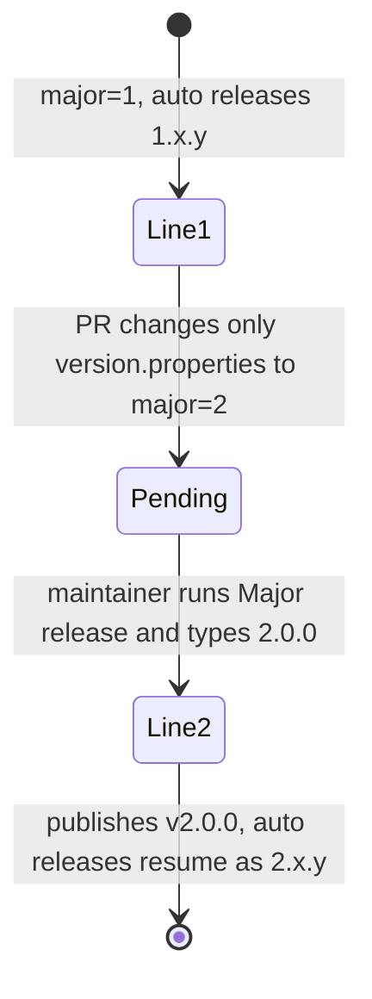

1. Open a PR titled `release: major X.0.0` that changes **only** `version.properties` to
   `major=X`. Once it is merged, automatic releases pause.
2. Go to *Actions → Major release → Run workflow* on `main` and type `X.0.0` to confirm.
3. The workflow checks your permission (admin or maintain), re-validates the file against the
   released tags, builds and signs the APKs, and publishes `vX.0.0`.

---

## 🔧 Build from source

| Tool | Version |
|---|---|
| JDK | 17 (Gradle 9.9 runs on 17+) |
| Android SDK | platform 37.1 (downloaded automatically by the build), build-tools 37 |
| NDK | 27.1.12297006 (r27b) |
| CMake | 3.22.1 (SDK package) |

```sh
git clone https://github.com/PN-Projects/TarangFX_android.git && cd TarangFX_android
./gradlew :app:assembleDebug -Pabi=arm64-v8a      # phone APK (one ABI = faster native build)
./gradlew :app:assembleDebug                      # arm64-v8a + x86_64
./gradlew :app:verifyApkHygieneDebug              # fails if network permissions or design refs leak in
```

The FFmpeg static libraries are prebuilt in `app/src/main/cpp/third_party/ffmpeg/<abi>/`. To
rebuild them, see [FFmpeg](#ffmpeg) below.

**Release signing** is read only from environment variables:

- `TFX_RELEASE_KEYSTORE`
- `TFX_RELEASE_STORE_PASSWORD`
- `TFX_RELEASE_KEY_ALIAS`
- `TFX_RELEASE_KEY_PASSWORD`

Without them the release APK is unsigned. Official builds are signed only by the CI release
pipeline, from encrypted repository secrets.

## 📂 Project structure

```text
TarangFX_android/
├── app/
│   ├── src/main/java/com/pnprojects/tarangfx/
│   │   ├── ui/            Compose screens: home, intro, trim, merge, mix, split, record,
│   │   │                  convert, denoise, fx, metadata, outputs, picker, settings,
│   │   │                  components (waveforms, sheets), navigation, theme
│   │   ├── audio/         PlaybackController, ExportManager, SelectionHolder
│   │   ├── data/          db (Room), media (MediaStore, outputs, waveforms), prefs
│   │   ├── domain/        model (Project, DspSettings, PeakRangeMax), undo
│   │   ├── nativebridge/  NativeAudio.kt — the JNI surface
│   │   ├── service/       ExportForegroundService
│   │   ├── ai/ di/        model installer, Hilt modules
│   ├── src/main/cpp/
│   │   ├── engine/        AudioEngine, MultitrackMixer, ClipRenderer, OfflineRenderer,
│   │   │                  WaveformExtractor, Recorder, ProjectModel
│   │   ├── dsp/           biquads, EQ, bass, reverb, dynamics, limiter, loudness meter
│   │   ├── ai/            streaming ONNX denoisers
│   │   ├── io/            FFmpeg decoder/encoder/remux, TagLib bridge
│   │   ├── common/        lock-free ring buffer, logging
│   │   ├── jni/           NativeBridge.cpp
│   │   └── third_party/   FFmpeg (prebuilt), TagLib, Rubber Band, nlohmann/json
│   ├── src/test/          JVM unit tests
│   └── src/androidTest/   on-device integration tests
├── tests/native/          C++ DSP tests and benchmarks
├── tools/
│   ├── versioning/        version.py: the release policy and its self-tests
│   ├── release/           local signing helpers (Windows)
│   ├── ci/                gradlew-retry.sh (retries only download failures)
│   ├── e2e/               UI regression harness and audio analysers
│   └── ffmpeg/            reproducible FFmpeg build script
├── .github/               workflows, CODEOWNERS, Dependabot, issue forms
├── version.properties     the major version line (see Versioning)
└── LICENSE                GNU AGPL v3.0
```

---

## 🤝 Contributing

Contributions of every size are welcome: bug reports, fixes, features, tests, translations of the
UI text, and documentation. `main` is protected: **nobody, maintainers included, can push to it
directly**. Every change arrives through a reviewed pull request.

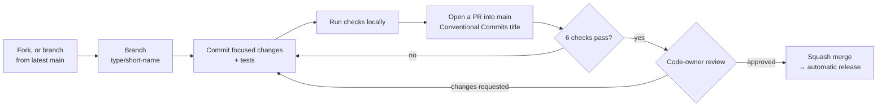

<details open>
<summary><b>1. Set up</b></summary>

1. Install JDK 17 and the Android SDK (NDK 27.1.12297006 and CMake 3.22.1 from the SDK manager).
2. Fork the repository, then clone your fork and add the upstream remote:
   ```sh
   git clone https://github.com/<you>/TarangFX_android.git
   cd TarangFX_android
   git remote add upstream https://github.com/PN-Projects/TarangFX_android.git
   ```
3. Build once: `./gradlew :app:assembleDebug -Pabi=arm64-v8a` (the first native build takes a few minutes).

</details>

<details open>
<summary><b>2. Branch from the latest <code>main</code></b></summary>

```sh
git fetch upstream && git switch -c feat/mix-snap-to-beat upstream/main
```

| Prefix | Use for |
|---|---|
| `feat/` | New user-visible functionality |
| `fix/` | Bug fixes |
| `perf/` | Performance work (include before/after numbers) |
| `refactor/` | Code changes with no behaviour change |
| `test/` | Tests only |
| `docs/` | README only (the only Markdown file in this repository) |
| `build/` `ci/` | Build scripts, dependencies, workflows (maintainer review required) |

Never reuse a branch after its PR is merged; start a new one from the latest `main`.

</details>

<details open>
<summary><b>3. Write the change</b></summary>

**Code style**
- **Kotlin:** official style, immutable UI state, no work on the main thread that can block (JNI calls that decode, render or read tags run on IO dispatchers).
- **C++20:** follow the existing `tfx` namespace conventions, RAII, no exceptions across JNI, and fixed-size buffers allocated in `prepare()`.
- **Comments:** explain *why*, especially for security-relevant or real-time decisions.

**Real-time audio rules.** These are hard rules for anything on the Oboe callback or inside per-sample DSP:

| ✅ Do | ❌ Never |
|---|---|
| Pre-allocate in `prepare()` | `new`, `malloc`, `std::vector::push_back` |
| Use the SPSC rings and atomics | Mutexes, condition variables, `sleep` |
| Apply parameter changes between blocks | File, network or log I/O |
| Keep per-sample work O(1) | Unbounded loops, per-sample `pow`/`log` when a control-rate value will do |

**Adding a DSP effect** (example walkthrough):
1. Implement it in `app/src/main/cpp/dsp/` with `prepare()`, `setParams()`, `process()` and `reset()`.
2. Wire it into `DspChain` and add its fields to `DspParams`, then mirror them in `DspSettings.kt` (same JSON names).
3. Decide whether changing it needs a renderer rebuild (`sameStructure` / `needsRebuildFrom`), and keep both sides in sync.
4. Add native tests in `tests/native/dsp_tests.cpp`: a reference value or invariant, plus a benchmark.
5. Add the UI controls, and a unit test for any Kotlin-side logic.

</details>

<details open>
<summary><b>4. Test before you push</b></summary>

```sh
./gradlew :app:testDebugUnitTest                                   # JVM unit tests
cmake -S tests/native -B build/native && cmake --build build/native && ./build/native/dsp_tests
./gradlew :app:connectedDebugAndroidTest -Pabi=x86_64              # needs an emulator or device
python3 tools/versioning/version.py selftest
```

Behaviour changes need tests. Performance claims need before/after measurements, using the native
benchmark or a unit-test timing like `PeakRangeMaxTest`.

</details>

<details open>
<summary><b>5. Open the pull request</b></summary>

The PR title must follow [Conventional Commits](https://www.conventionalcommits.org/), because it becomes the squash commit and the release-note line:

| Example title | When |
|---|---|
| `feat(trim): add fade presets` | New feature (ask a maintainer for `semver:minor`) |
| `fix: crash when the source file is empty` | Bug fix |
| `perf(dsp): vectorise the 10-band EQ` | Performance |
| `docs: clarify the major-release process` | README |

Allowed types: `feat`, `fix`, `perf`, `refactor`, `docs`, `test`, `build`, `ci`, `chore`, `revert`,
`style`, `release`.

**PR checklist**
- [ ] Branched from the latest `main`, and kept up to date before merge
- [ ] One logical change; no unrelated reformatting
- [ ] Tests added or updated; all six checks green
- [ ] No new permissions, network access, ads, tracking or paywalls
- [ ] `version.properties`, release workflows and signing are untouched (maintainer-only)
- [ ] No secrets, keystores, personal data or copyrighted media
- [ ] Screenshots attached for UI changes

**Required checks:** PR title · Version guard · Unit tests · Native DSP tests · Build (debug APK) · Integration tests (emulator).
A code-owner approval is required, and all review conversations must be resolved.

</details>

<details>
<summary><b>Labels</b></summary>

| Label | Meaning |
|---|---|
| `semver:minor` | Merging releases a minor version |
| `skip-release` | Merging releases nothing (README, CI tweaks) |
| `needs-triage` | Waiting for a moderator |
| `good first issue` / `help wanted` | Great places to start |
| `bug` / `enhancement` / `question` | Issue type |
| `dependencies` / `release` | Dependency updates / release engineering |

</details>

**Licensing of contributions:** by opening a pull request you agree that your contribution is
licensed under the project's license (AGPL-3.0-or-later), and you confirm you have the right to
submit it.

## 🚦 Moderation guide

For maintainers and moderators (people with *triage*, *write*, *maintain* or *admin* access).

| Role | Can |
|---|---|
| **Triage** | Label, assign and close issues and PRs |
| **Write** | Review and approve PRs (code owners' approval is what counts) |
| **Maintain** | Everything above, plus run the Major release workflow |
| **Admin** | Repository settings, rulesets and signing secrets |

<details open>
<summary><b>Triage</b></summary>

- **New issues:** label them within a few days, and remove `needs-triage` once handled.
- **Duplicates and off-topic requests:** close duplicates with a link to the original. Politely close requests that conflict with the [principles](#-principles), naming the principle.
- **Security reports in public:** move them to a private advisory immediately, and hide the sensitive details.

</details>

<details open>
<summary><b>Reviewing and merging</b></summary>

- **Review for:** correctness, tests, security, real-time safety, performance and the principles.
- **How to merge:** only by **squash merge**, after every required check is green. **Never merge with failing or skipped checks**, even where your role technically allows a bypass.
- **Self-merging:** don't approve your own work when another reviewer is available. Admins can merge their own PR without a second approval only through a PR; nobody, admins included, can push to `main` directly.
- **Release labels:** add `semver:minor` for user-visible features, and `skip-release` for changes that don't affect the app.
- **Dependabot:** review its PRs like any other; never auto-merge. Its merges never publish a release.
- **History and releases:** never rewrite `main` history. Release tags are immutable by ruleset.

</details>

<details open>
<summary><b>Releases and secrets</b></summary>

- **Major releases** follow the [process above](#-versioning-and-releases).
- **Signing secrets:** only admins manage them (`TFX_KEYSTORE_BASE64`, `TFX_KEYSTORE_PASSWORD`, `TFX_KEY_ALIAS`, `TFX_KEY_PASSWORD`).
- **Key backup:** keep the keystore backed up offline and encrypted. Losing it means users cannot upgrade.
- **Rotation:** rotate the passwords when someone with access leaves.

</details>

<details open>
<summary><b>Enforcing the Code of Conduct</b></summary>

Follow the four-step ladder in the [Code of Conduct](#-code-of-conduct):

1. Correction
2. Warning
3. Temporary ban
4. Permanent ban

Keep a private record of every decision among maintainers. Respect the reporter's privacy, and be fair, consistent and kind.

</details>

## 📜 Code of Conduct

We are committed to a welcoming, harassment-free community. **In short:** be kind, be patient,
assume good intent, give and accept feedback gracefully, and focus on what is best for the
community. Harassment, insults, discriminatory language, sexualised content and publishing others'
private information are never acceptable.

Report concerns **privately** to the maintainers through
[GitHub private reporting](https://github.com/PN-Projects/TarangFX_android/security/advisories/new)
(start the title with "Code of Conduct"). Every report is reviewed promptly, fairly and
confidentially.

<details>
<summary><b>Read the full Code of Conduct (Contributor Covenant 2.1)</b></summary>

### Our Pledge

We as members, contributors, and leaders pledge to make participation in our community a
harassment-free experience for everyone, regardless of age, body size, visible or invisible
disability, ethnicity, sex characteristics, gender identity and expression, level of experience,
education, socio-economic status, nationality, personal appearance, race, caste, color, religion,
or sexual identity and orientation.

We pledge to act and interact in ways that contribute to an open, welcoming, diverse, inclusive,
and healthy community.

### Our Standards

Examples of behavior that contributes to a positive environment for our community include:

* Demonstrating empathy and kindness toward other people
* Being respectful of differing opinions, viewpoints, and experiences
* Giving and gracefully accepting constructive feedback
* Accepting responsibility and apologizing to those affected by our mistakes, and learning from
  the experience
* Focusing on what is best not just for us as individuals, but for the overall community

Examples of unacceptable behavior include:

* The use of sexualized language or imagery, and sexual attention or advances of any kind
* Trolling, insulting or derogatory comments, and personal or political attacks
* Public or private harassment
* Publishing others' private information, such as a physical or email address, without their
  explicit permission
* Other conduct which could reasonably be considered inappropriate in a professional setting

### Enforcement Responsibilities

Community leaders are responsible for clarifying and enforcing our standards of acceptable
behavior and will take appropriate and fair corrective action in response to any behavior that
they deem inappropriate, threatening, offensive, or harmful.

Community leaders have the right and responsibility to remove, edit, or reject comments, commits,
code, wiki edits, issues, and other contributions that are not aligned to this Code of Conduct,
and will communicate reasons for moderation decisions when appropriate.

### Scope

This Code of Conduct applies within all community spaces, and also applies when an individual is
officially representing the community in public spaces. Examples of representing our community
include using an official e-mail address, posting via an official social media account, or acting
as an appointed representative at an online or offline event.

### Enforcement

Instances of abusive, harassing, or otherwise unacceptable behavior may be reported to the
community leaders responsible for enforcement through
[GitHub private reporting](https://github.com/PN-Projects/TarangFX_android/security/advisories/new)
on this repository. All complaints will be reviewed and investigated promptly and fairly.

All community leaders are obligated to respect the privacy and security of the reporter of any
incident.

### Enforcement Guidelines

Community leaders will follow these Community Impact Guidelines in determining the consequences
for any action they deem in violation of this Code of Conduct:

#### 1. Correction

**Community Impact**: Use of inappropriate language or other behavior deemed unprofessional or
unwelcome in the community.

**Consequence**: A private, written warning from community leaders, providing clarity around the
nature of the violation and an explanation of why the behavior was inappropriate. A public apology
may be requested.

#### 2. Warning

**Community Impact**: A violation through a single incident or series of actions.

**Consequence**: A warning with consequences for continued behavior. No interaction with the people
involved, including unsolicited interaction with those enforcing the Code of Conduct, for a
specified period of time. This includes avoiding interactions in community spaces as well as
external channels like social media. Violating these terms may lead to a temporary or permanent
ban.

#### 3. Temporary Ban

**Community Impact**: A serious violation of community standards, including sustained
inappropriate behavior.

**Consequence**: A temporary ban from any sort of interaction or public communication with the
community for a specified period of time. No public or private interaction with the people
involved, including unsolicited interaction with those enforcing the Code of Conduct, is allowed
during this period. Violating these terms may lead to a permanent ban.

#### 4. Permanent Ban

**Community Impact**: Demonstrating a pattern of violation of community standards, including
sustained inappropriate behavior, harassment of an individual, or aggression toward or
disparagement of classes of individuals.

**Consequence**: A permanent ban from any sort of public interaction within the community.

### Attribution

This Code of Conduct is adapted from the [Contributor Covenant](https://www.contributor-covenant.org),
version 2.1, available at
[https://www.contributor-covenant.org/version/2/1/code_of_conduct.html](https://www.contributor-covenant.org/version/2/1/code_of_conduct.html).

Community Impact Guidelines were inspired by
[Mozilla's code of conduct enforcement ladder](https://github.com/mozilla/diversity).

For answers to common questions about this code of conduct, see the FAQ at
[https://www.contributor-covenant.org/faq](https://www.contributor-covenant.org/faq). Translations
are available at [https://www.contributor-covenant.org/translations](https://www.contributor-covenant.org/translations).

</details>

## 🔒 Security

> [!CAUTION]
> **Never report vulnerabilities in public issues.** Use
> [GitHub private vulnerability reporting](https://github.com/PN-Projects/TarangFX_android/security/advisories/new),
> with the affected version, steps to reproduce and the impact. Maintainers aim to acknowledge
> reports within 7 days. Only the latest release receives security fixes.

| Layer | Protection |
|---|---|
| **App** | No network permission; app data excluded from backups; least-privilege media permissions requested just in time; no `FileProvider` (sharing uses one-shot MediaStore grants) |
| **Native code** | Stack protector, `_FORTIFY_SOURCE=2`, full RELRO, non-executable stack, 16 KB-page aligned |
| **Supply chain** | Every GitHub Action pinned to a full commit SHA; FFmpeg sources verified by GPG signature and SHA-256; model files pinned by SHA-256; Dependabot alerts and updates |
| **CI** | Read-only token by default; no `pull_request_target`, so code from forks never sees secrets; clean-room release builds with no shared cache; secret scanning with push protection |
| **Repository** | Protected `main` (reviews, 6 required checks, linear history, no force-push or deletion); immutable release tags; signing key only in encrypted secrets |

## 📦 Third-party components

| Component | Version | Use | License |
|---|---|---|---|
| FFmpeg | 7.1.5 | Decoding, encoding, muxing (audio-only static build) | LGPL-2.1-or-later |
| LAME | 3.100 | MP3 encoding | LGPL-2.0-or-later |
| libopus / libvorbis / libogg | 1.5.2 / 1.3.7 / 1.3.5 | Opus / Vorbis / Ogg | BSD-3-Clause |
| Rubber Band Library | 4.0.0 | Time-stretch and pitch-shift | GPL-2.0-or-later |
| TagLib + utfcpp | 2.0.2 / 4.0.6 | Tags and cover art | LGPL-2.1 / MPL-1.1, BSL-1.0 |
| Google Oboe | 1.11.2 | Low-latency audio I/O | Apache-2.0 |
| ONNX Runtime | 1.32.0 | On-device AI inference | MIT |
| nlohmann/json | 3.11.3 | JSON | MIT |
| GTCRN model (`gtcrn_simple.onnx`) | commit `502ebfa` | Fast denoise, 16 kHz | MIT |
| DeepFilterNet3 torchDF export (`dfn3_stream.onnx`) | `torchDF_main@408414f` | Studio denoise, 48 kHz | MIT OR Apache-2.0 |
| Plus Jakarta Sans | — | UI font | OFL-1.1 |

License texts of the bundled sources are kept next to them in `app/src/main/cpp/third_party/`.

<details>
<summary><b id="ffmpeg">FFmpeg build provenance</b></summary>

The static libraries were built with `tools/ffmpeg/build_ffmpeg_android.sh` (MSYS2, NDK r27b),
audio-only, with network protocols disabled and without `--enable-gpl`/`--enable-nonfree`. The
script refuses any source tarball whose SHA-256 differs from these values:

| Source | SHA-256 |
|---|---|
| ffmpeg-7.1.5.tar.xz (also GPG-verified against FFmpeg's release key `FCF9 86EA 15E6 E293 A564 4F10 B432 2F04 D676 58D8`) | `de668509caf9e35e3cd162473441fdb29538c6d96ed080292b3cf9e6fc5d558f` |
| lame-3.100.tar.gz | `ddfe36cab873794038ae2c1210557ad34857a4b6bdc515785d1da9e175b1da1e` |
| libogg-1.3.5.tar.xz | `c4d91be36fc8e54deae7575241e03f4211eb102afb3fc0775fbbc1b740016705` |
| libvorbis-1.3.7.tar.xz | `b33cc4934322bcbf6efcbacf49e3ca01aadbea4114ec9589d1b1e9d20f72954b` |
| opus-1.5.2.tar.gz | `65c1d2f78b9f2fb20082c38cbe47c951ad5839345876e46941612ee87f9a7ce1` |

</details>

<details>
<summary><b id="ai-models">AI models</b></summary>

| File | SHA-256 | Source |
|---|---|---|
| `gtcrn_simple.onnx` (535,190 B) | `b4718df6228e7bdf1a8a435cf98f838636eb2fd331acabf86ba87c5192ebcb87` | [Xiaobin-Rong/gtcrn](https://github.com/Xiaobin-Rong/gtcrn) `stream/onnx_models/gtcrn_simple.onnx` @ `502ebfab` |
| `dfn3_stream.onnx` (12,911,035 B) | `b758c49d6708a5b7979e3de185705a8a4915076c862fb17b1b304d9a72b75cdc` | [grazder/DeepFilterNet](https://github.com/grazder/DeepFilterNet) `torchDF_main` @ `408414f2`, `models/DeepFilterNet3_torchDF_onnx.tar` |

The models ship inside the APK under `app/src/main/assets/models/` and are never downloaded. The
DeepFilterNet3 file is a community streaming export with a 512-sample hop, fine-tuned by the fork's
authors; it is not the upstream project's official weights.

</details>

### Known limitations

- **Emulators only so far:** verification has run on x86_64 emulators. Real-device latency, Studio-denoise real-time headroom on phone CPUs, and OEM audio stacks still need field testing.
- **No background recording:** Android silences the mic for background apps without a microphone-type service, so the recorder keeps the screen on instead.
- **Preview vs export quality:** time-stretch previews use Rubber Band's faster R2 engine, while exports use R3.
- **Mono denoiser output:** denoisers process a mono mid signal. At 100% strength the output is mono; lower strengths blend the original stereo back in.
- **Loudness on export only:** normalisation needs the whole programme, so it is applied during export.

## 📄 License

TarangFX is free software under the **GNU Affero General Public License v3.0 or later**
(AGPL-3.0-or-later). See [LICENSE](LICENSE). The complete source of every release is this
repository at the release tag.

Bundled components keep their own licenses (see [Third-party components](#-third-party-components)).
Rubber Band Library is GPL-2.0-or-later and may be used under GPL-3.0; section 13 of both GPLv3
and AGPLv3 explicitly allows combining GPLv3 and AGPLv3 code.

---

<div align="center">

**TarangFX**: every wave, on your device.

Made with ♥ at **PN-projects** by **TeamPrabodhNandini**

[Download](https://github.com/PN-Projects/TarangFX_android/releases/latest) · [Report a bug](https://github.com/PN-Projects/TarangFX_android/issues/new/choose) · [Contribute](#-contributing)

</div>
