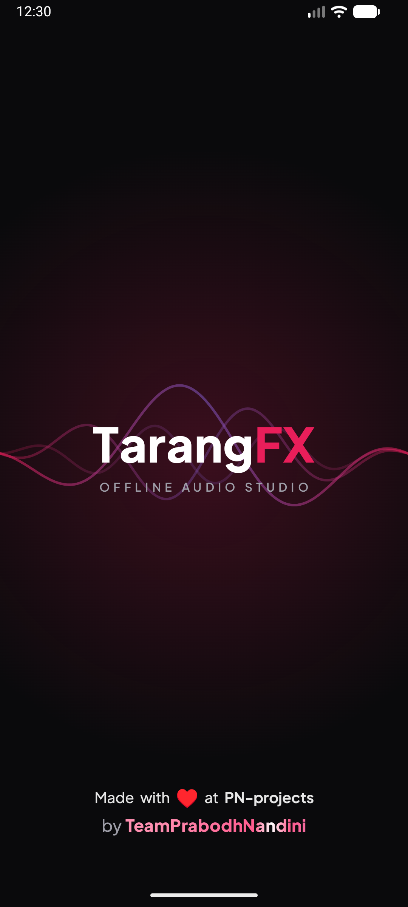

<div align="center">

# TarangFX

**A studio-grade audio editor for Android that never touches the internet.**

Trim · Merge · Multitrack mix · Split · Record · Convert · Video → audio · AI denoise · FX & EQ · Tags

[](https://github.com/PN-Projects/TarangFX_android/actions/workflows/ci.yml)
[](https://github.com/PN-Projects/TarangFX_android/actions/workflows/release.yml)
[](https://github.com/PN-Projects/TarangFX_android/releases/latest)
[](LICENSE)


&nbsp;&nbsp;


*Made with ♥ at **PN-projects** by **TeamPrabodhNandini***

</div>

---

*Tarang* (तरंग) means **wave**. TarangFX is a free, open-source, ad-free audio workstation for
Android. A Kotlin + Jetpack Compose UI sits on a C++20 engine (Google Oboe, FFmpeg, Rubber Band,
TagLib, ONNX Runtime). Everything, including the AI noise removal, runs on the phone: the app has
**no INTERNET permission**, no analytics, no accounts, no ads and no paywalls.

> ⚠️ This project **requires human review** (security, licensing, audio correctness and testing on
> real devices) before it is relied on in production. CI verifies it on an emulator; see
> [Known limitations](#known-limitations).

## Contents

- [Features](#features)
- [Download](#download)
- [Principles](#principles)
- [Build from source](#build-from-source)
- [Testing](#testing)
- [Architecture](#architecture)
- [Versioning & releases](#versioning--releases)
- [Contributing](#contributing)
- [Moderation guide](#moderation-guide)
- [Code of Conduct](#code-of-conduct)
- [Security](#security)
- [Third-party components](#third-party-components)
- [License](#license)

## Features

| Tool | What it does |
|---|---|
| **Trim** | Sample-accurate keep/delete selection, draggable handles, pinch-zoom waveform, fades, quick FX |
| **Merge** | Join files in any order, per-clip trim/FX/speed, crossfades |
| **Multitrack mix** | Tracks and clips with drag + magnetic snapping, split, fades, mute/solo, per-clip FX and AI denoise, undo/redo, live mic overdub, drafts |
| **Split** | Multiple split points, delete parts, batch export with track numbers |
| **Ringtone** | Saves straight into the system ringtone / notification / alarm folders |
| **Record** | WAV (16/24-bit), FLAC or M4A, input gain, pause/resume, live waveform, optional live denoise |
| **Convert** | MP3, AAC, M4A, FLAC, WAV, OPUS, OGG, ALAC; batch; tags and cover art carried over |
| **Video → audio** | Bit-exact stream copy (no quality loss) or transcode |
| **AI Denoise** | *Studio* (DeepFilterNet3, 48 kHz) and *Fast* (GTCRN, 16 kHz) models, on-device |
| **Voice Enhance** | Denoise + high-pass + dynamic de-esser + presence EQ + compressor, normalised to −14 LUFS (EBU R128) |
| **FX & EQ** | 10-band EQ with presets, bass boost, reverb presets, speed and pitch (Rubber Band), hold-to-compare A/B |
| **Tag editor** | Title/artist/album/year/track/genre and cover art (photo picker, auto-cropped) |
| **Outputs** | Library of everything you made: play, rename, share, re-edit, set as ringtone, delete |

Edits are **non-destructive**: your original files are only ever read. Every export is a new file
in `Music/TarangFX/`.

## Download

Get the latest signed APK from **[Releases](https://github.com/PN-Projects/TarangFX_android/releases/latest)**:

| File | Install on |
|---|---|
| `TarangFX-<version>-arm64-v8a.apk` | Android phones and tablets (Android 8.0+, 64-bit ARM) |
| `TarangFX-<version>-x86_64.apk` | Emulators and x86 Chromebooks |

Check the download against `SHA256SUMS.txt` in the same release, then open the APK on your phone
(allow "Install unknown apps" for your browser or file manager).

## Principles

These are non-negotiable and are enforced in review and in CI:

1. **100% offline.** No network permission, ever (`verifyApkHygiene*` fails the build otherwise).
2. **Free for everyone.** No ads, paywalls, subscriptions, accounts or telemetry.
3. **Non-destructive.** Never modify the user's source files.
4. **Respect the device.** Stream audio in fixed chunks (memory never grows with file length);
   the real-time audio thread never allocates, locks or does I/O.

## Build from source

| Tool | Version |
|---|---|
| JDK | 17 |
| Android SDK | platform 35, build-tools 35 |
| NDK | 27.1.12297006 (r27b) |
| CMake | 3.22.1 (SDK package) |

```sh
./gradlew :app:assembleDebug                      # debug APK, both ABIs
./gradlew :app:assembleDebug -Pabi=arm64-v8a      # phone-only (faster native build)
./gradlew :app:verifyApkHygieneDebug              # fails if network permissions or design refs leak in
```

The FFmpeg static libraries are prebuilt in `app/src/main/cpp/third_party/ffmpeg/<abi>/`; to
rebuild them, see [FFmpeg](#ffmpeg) below.

**Release signing** is read only from the environment (`TFX_RELEASE_KEYSTORE`,
`TFX_RELEASE_STORE_PASSWORD`, `TFX_RELEASE_KEY_ALIAS`, `TFX_RELEASE_KEY_PASSWORD`); without them
the release APK is unsigned. Official builds are signed only by the CI release pipeline, from
encrypted repository secrets. For a local signed build on Windows,
`tools/release/build-release.ps1` creates a personal key outside the repository with a
DPAPI-encrypted password.

## Testing

| Suite | Command | Runs in CI |
|---|---|---|
| JVM unit tests | `./gradlew :app:testDebugUnitTest` | ✅ every PR |
| Native DSP tests + benchmarks (C++) | `cmake -S tests/native -B build/native && cmake --build build/native && build/native/dsp_tests` | ✅ every PR (host build) |
| Integration tests (device/emulator) | `./gradlew :app:connectedDebugAndroidTest -Pabi=x86_64` | ✅ every PR (API 34 emulator) |
| Versioning policy self-test | `python3 tools/versioning/version.py selftest` | ✅ every PR and release |
| UI regression suite (24 checks) | `tools/e2e/regression.ps1 -Apk <apk> -Media <folder>` (Windows, adb, ffmpeg) | manual, before major releases |

Highlights of what is verified:

- **Loudness:** the meter conforms to EBU Tech 3341 (±0.1 LU), and Voice Enhance exports measure −14.0 LUFS in ffmpeg.
- **Editing accuracy:** trims are sample-accurate (within 1 LSB), and video → audio stream copy is bit-exact.
- **Correctness of optimised code:** the limiter's monotonic-deque look-ahead matches a brute-force reference, and the waveform range-max index matches brute force on 24,000 random ranges.
- **Storage and MediaStore:** files land in the right folders with the right flags, and staged files are cleaned up.

The native suite also runs on a device via `tests/native/run_native_tests.ps1`, and test media
for the regression suite is generated with `tools/e2e/gen_wav.py` and `tools/e2e/addnoise.py`.

## Architecture

```
Compose UI (ui/*)  ──>  ViewModels  ──>  PlaybackController / ExportManager (audio/*)
                                                   │ JNI (nativebridge/NativeAudio.kt)
                                                   ▼
C++20 core (app/src/main/cpp, namespace tfx, libtarangfx.so)
  engine/AudioEngine       Oboe output; RT callback only pops lock-free SPSC rings
  engine/MultitrackMixer   shared by live preview AND offline export (identical output)
  engine/ClipRenderer      decoder → AI denoise → Rubber Band → fades/gain → DSP chain
  engine/OfflineRenderer   chunked (4096-frame) export; optional EBU R128 normalisation with a
                           safeguarded secant search on the post-limiter loudness (±0.05 LU)
  engine/WaveformExtractor streaming peaks (100/s) → .peaks cache; the UI queries them through a
                           block + segment-tree range-max index (O(log n) per bar)
  engine/Recorder          Oboe input → ring → writer thread → encoder
  dsp/*                    RBJ biquads (zipper-free coefficient ramps), 10-band EQ, bass boost,
                           Freeverb-style reverb, look-ahead limiter (monotonic-deque sliding
                           minimum), compressor, dynamic-EQ de-esser, BS.1770-4 loudness meter
  io/*                     fd-based FFmpeg decoder (sample-accurate seek), encoder/muxer,
                           stream-copy remux, TagLib bridge (tags + cover art)
  ai/*                     ONNX Runtime streaming denoisers (GTCRN, DeepFilterNet3)
```

- **Scoped storage:** MediaStore with `IS_PENDING`; staging in no-backup app storage, which Android never purges mid-export.
- **Background exports:** they run in a foreground service (`mediaProcessing` on Android 15+, `dataSync` below) with progress and Cancel.
- **Hardened native code:** built with stack protector, FORTIFY, full RELRO and no exec stack, and aligned for 16 KB pages (Android 15+).
- **Lean release builds:** R8 shrinking, `-O3` + ThinLTO native code, one APK per ABI.

### Known limitations

- **Tested on emulators only:** verification so far ran on x86_64 emulators. Real-device latency, Studio-denoise real-time headroom on phone CPUs, and OEM audio stacks still need field testing.
- **No background recording:** Android silences the mic for background apps without a microphone-type service, so the recorder keeps the screen on instead.
- **Preview vs export quality:** time-stretch previews use Rubber Band's faster R2 engine, while exports use R3.
- **Loudness on export only:** normalisation needs the whole programme, so it is applied during export.
- **Mono denoiser output:** denoisers process a mono mid signal. At 100% strength the output is mono; lower strengths blend the original stereo back in.

## Versioning & releases

TarangFX uses `MAJOR.MINOR.PATCH`. Releases are fully automated; **nobody edits version numbers
by hand**.

| What happens | Result |
|---|---|
| A pull request is merged into `main` | CI publishes the next **patch** (`1.4.6 → 1.4.7`), signed APKs + checksums + generated release notes |
| The merged PR has the label `semver:minor` | CI publishes the next **minor** instead (`1.4.6 → 1.5.0`) |
| Patch reaches 99 | It rolls over (`1.4.99 → 1.5.0`); minor and patch are each limited to 0–99 |
| Version reaches `x.99.99` | Automatic releases stop: a **major release** is required |
| A **Dependabot** PR is merged | **No release.** Dependency and Actions updates ship with the next real release |
| The merged PR has the label `skip-release` | **No release** (for changes that don't affect the app, e.g. README or CI tweaks) |
| Major release | Manual and maintainer-only (see below) |

The first release is **1.0.0**. Android's `versionCode` is `major×10000 + minor×100 + patch`, so it
always increases.

**The versioning file.** [`version.properties`](version.properties) holds only the major line
(`major=1`). It is required, and the **Version guard** check fails a pull request when:

- the file is missing or malformed (anything other than one `major=<integer>`);
- `major` is anything except the released major or exactly +1 (no skipping, no downgrades);
- a major bump is mixed with any other change;
- a version number is hard-coded in `app/build.gradle.kts`;
- the build is asked for a version outside the file's major line (Gradle refuses it).

**Major release process** (maintainers):

1. Open a PR titled `release: major X.0.0` that changes **only** `version.properties` to
   `major=X`. Automatic releases pause once it is merged.
2. Go to *Actions → Major release → Run workflow* on `main`, and type `X.0.0` to confirm.
3. The workflow checks your permission (admin or maintain), re-validates the file against the
   released tags, builds and signs the APKs, and publishes `vX.0.0`.

## Contributing

Contributions are welcome. `main` is protected: **nobody, including maintainers, can push to it
directly.** Every change arrives through a reviewed pull request.

1. **Fork** the repository (or, if you are a member, create a branch) from the **latest `main`**.
2. Name your branch `<type>/<short-description>`, for example `feat/mix-snap-to-beat`,
   `fix/trim-zero-length`, `docs/readme-typo`.
3. Make focused commits. Keep one logical change per pull request.
4. Run the checks locally before pushing: `./gradlew :app:testDebugUnitTest` and the native DSP tests.
5. Open a pull request **into `main`**. The title must follow
   [Conventional Commits](https://www.conventionalcommits.org/): `feat(trim): add fade presets`,
   `fix: crash on empty file`. Allowed types are `feat`, `fix`, `perf`, `refactor`, `docs`,
   `test`, `build`, `ci`, `chore`, `revert`, `style` and `release`. The title becomes the squash
   commit and the release-note line.
6. Keep your branch up to date with `main` (the ruleset requires it before merging).

**Your pull request must:**

- pass every required check: *PR title, Version guard, Unit tests, Native DSP tests, Build
  (debug APK), Integration tests (emulator)*;
- get an approving review from a code owner, with all review conversations resolved;
- add or update tests for behaviour changes, and include before/after measurements for
  performance claims;
- respect the [principles](#principles): no network access, ads, tracking or paywalls, and no new
  permissions without maintainer agreement;
- not modify `version.properties`, release workflows or signing configuration, which are
  maintainer-only;
- contain no secrets, keystores, personal data or copyrighted media.

**Code style:** match the surrounding code. Kotlin follows the official style; C++20 follows the
existing `tfx` namespace conventions. The real-time audio path must stay allocation-free and
lock-free.

**Licensing of contributions:** by submitting a pull request you agree that your contribution is
licensed under the project's license (AGPL-3.0-or-later), and you confirm you have the right to
submit it.

## Moderation guide

For maintainers and moderators (people with *triage*, *write*, *maintain* or *admin* access).

**Triage**
- Label new issues within a few days: `bug`, `enhancement`, `question`, `duplicate`,
  `wontfix`, `good first issue`, `help wanted`. Remove `needs-triage` once handled.
- Close duplicates with a link to the original. Close off-topic or principle-violating requests
  politely, explaining which principle applies.
- Move any security report from a public issue to a private advisory immediately, and hide
  the sensitive details.

**Reviewing and merging**
- Review for correctness, tests, security, performance on the audio thread, and the principles.
- Merge only with **squash merge**, after every required check is green. **Never merge with
  failing or skipped checks**, even where your role technically allows a bypass.
- Don't approve your own work when another reviewer is available. Admins can merge their own
  PR without a second approval (no one, not even admins, can push to `main` directly), but
  should use this only when no other reviewer exists.
- Add `semver:minor` before merging when a PR adds user-visible features. Leave it off for fixes
  and internal changes.
- Add `skip-release` before merging when a PR doesn't change the app (README, CI, issue
  templates). Dependabot PRs never release, so they need no label.
- Never rewrite `main` history, delete or recreate release tags, or edit published releases'
  assets.

**Releases and secrets**
- Major releases follow the [process above](#versioning--releases). Announce them in the
  release notes.
- Only admins manage the signing secrets (`TFX_KEYSTORE_BASE64`, `TFX_KEYSTORE_PASSWORD`,
  `TFX_KEY_ALIAS`, `TFX_KEY_PASSWORD`). The keystore must also be backed up offline and
  encrypted; losing it means users cannot upgrade. Rotate the passwords if a maintainer with
  access leaves.
- Review Dependabot PRs like any other PR. Never auto-merge dependency updates.

**Conduct enforcement** (escalate as needed):

1. A friendly reminder.
2. A formal warning.
3. A temporary interaction limit or ban.
4. A permanent ban.

Record the reason privately among maintainers, and be fair, consistent and kind.

## Code of Conduct

We follow the spirit of the [Contributor Covenant 2.1](https://www.contributor-covenant.org/version/2/1/code_of_conduct/):
be welcoming, patient and respectful. Harassment, personal attacks, discriminatory language,
publishing others' private information, and sustained disruption are not tolerated, in
issues, pull requests, discussions or anywhere the project is represented. Report problems
privately to the maintainers through a
[private advisory](https://github.com/PN-Projects/TarangFX_android/security/advisories/new),
marking it as a conduct report. Moderators act as described in the
[Moderation guide](#moderation-guide).

## Security

**Please do not report vulnerabilities in public issues.** Use
[GitHub private vulnerability reporting](https://github.com/PN-Projects/TarangFX_android/security/advisories/new).
Include the affected version, steps to reproduce and the impact. Maintainers aim to acknowledge
reports within 7 days. Only the latest release receives security fixes.

Security measures in this repository include:

- a protected `main` with required reviews and checks;
- least-privilege, SHA-pinned GitHub Actions, with no secrets exposed to pull requests from forks;
- signing keys held only in encrypted secrets;
- an app with no network permission, no backups of app data, and hardened native code;
- Dependabot updates for dependencies and Actions.

## Third-party components

| Component | Version | Use | License |
|---|---|---|---|
| FFmpeg | 7.1.5 | Decoding, encoding, muxing (audio-only static build) | LGPL-2.1-or-later |
| LAME | 3.100 | MP3 encoding | LGPL-2.0-or-later |
| libopus / libvorbis / libogg | 1.5.2 / 1.3.7 / 1.3.5 | Opus/Vorbis/Ogg | BSD-3-Clause |
| Rubber Band Library | 4.0.0 | Time-stretch and pitch-shift | GPL-2.0-or-later |
| TagLib + utfcpp | 2.0.2 / 4.0.6 | Tags and cover art | LGPL-2.1 / MPL-1.1, BSL-1.0 |
| Google Oboe | 1.9.0 | Low-latency audio I/O | Apache-2.0 |
| ONNX Runtime | 1.20.0 | On-device AI inference | MIT |
| nlohmann/json | 3.11.3 | JSON | MIT |
| GTCRN model (`gtcrn_simple.onnx`) | commit `502ebfa` | Fast denoise, 16 kHz | MIT |
| DeepFilterNet3 torchDF streaming export (`dfn3_stream.onnx`) | `torchDF_main@408414f` | Studio denoise, 48 kHz | MIT OR Apache-2.0 |
| Plus Jakarta Sans | — | UI font | OFL-1.1 |

License texts of the bundled sources are kept next to them in `app/src/main/cpp/third_party/`.

### FFmpeg

The static libraries were built with `tools/ffmpeg/build_ffmpeg_android.sh` (MSYS2, NDK r27b),
audio-only and with network protocols disabled. The script refuses any source tarball whose
SHA-256 differs from these values:

| Source | SHA-256 |
|---|---|
| ffmpeg-7.1.5.tar.xz (also GPG-verified against FFmpeg's release key `FCF9 86EA 15E6 E293 A564 4F10 B432 2F04 D676 58D8`) | `de668509caf9e35e3cd162473441fdb29538c6d96ed080292b3cf9e6fc5d558f` |
| lame-3.100.tar.gz | `ddfe36cab873794038ae2c1210557ad34857a4b6bdc515785d1da9e175b1da1e` |
| libogg-1.3.5.tar.xz | `c4d91be36fc8e54deae7575241e03f4211eb102afb3fc0775fbbc1b740016705` |
| libvorbis-1.3.7.tar.xz | `b33cc4934322bcbf6efcbacf49e3ca01aadbea4114ec9589d1b1e9d20f72954b` |
| opus-1.5.2.tar.gz | `65c1d2f78b9f2fb20082c38cbe47c951ad5839345876e46941612ee87f9a7ce1` |

### AI models

| File | SHA-256 | Source |
|---|---|---|
| `gtcrn_simple.onnx` (535,190 B) | `b4718df6228e7bdf1a8a435cf98f838636eb2fd331acabf86ba87c5192ebcb87` | [Xiaobin-Rong/gtcrn](https://github.com/Xiaobin-Rong/gtcrn) `stream/onnx_models/gtcrn_simple.onnx` @ `502ebfab` |
| `dfn3_stream.onnx` (12,911,035 B) | `b758c49d6708a5b7979e3de185705a8a4915076c862fb17b1b304d9a72b75cdc` | [grazder/DeepFilterNet](https://github.com/grazder/DeepFilterNet) `torchDF_main` @ `408414f2`, `models/DeepFilterNet3_torchDF_onnx.tar` |

The DeepFilterNet3 file is a community streaming export with a 512-sample hop, fine-tuned by the
fork's authors. It is not the upstream project's official weights.

## License

TarangFX is licensed under the **GNU Affero General Public License v3.0 or later**
(AGPL-3.0-or-later). See [LICENSE](LICENSE). The complete source of every release is this
repository.

Bundled components keep their own licenses (see [Third-party components](#third-party-components)).
Rubber Band Library is GPL-2.0-or-later, which may be used under GPL-3.0; section 13 of the GPLv3
and of the AGPLv3 explicitly allows combining GPLv3 and AGPLv3 code. The project's build and CI
tooling is open source too: for example, setup-gradle stays on the MIT-licensed v5, because v6+
bundles a proprietary caching component.

<div align="center">

Made with ♥ at **PN-projects** by **TeamPrabodhNandini**

</div>
